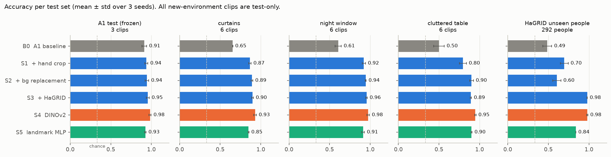
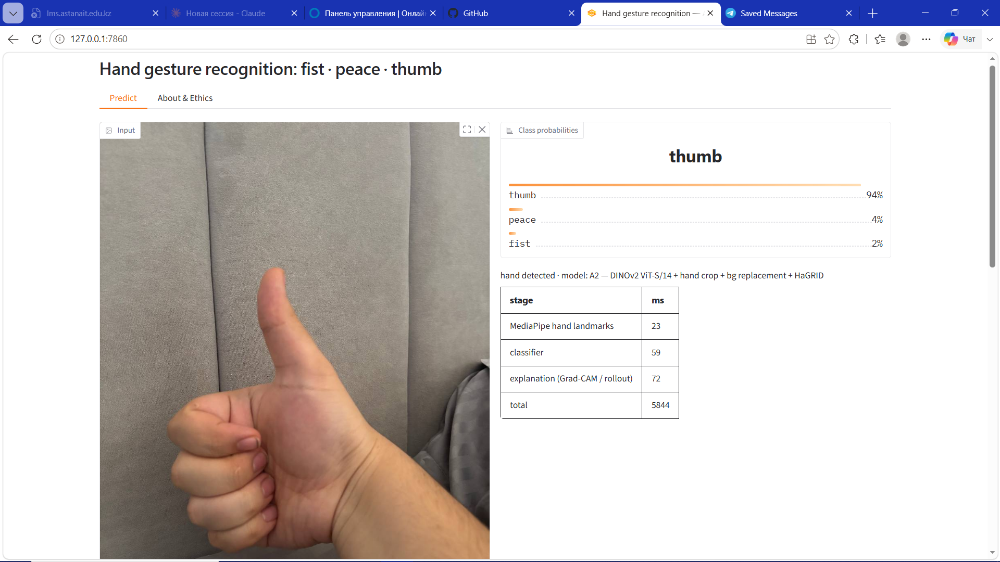

# Hand Gesture Recognition: A1 baseline → SOTA hand pipeline (A2)

Recognising three static hand gestures — **fist**, **peace** (V-sign) and **thumb** (thumbs-up).

* **Assignment 1** — a self-recorded dataset (11 clips, 720 frames), classical baselines and a
  ResNet-18. Report: [`REPORT.md`](REPORT.md), notebook: `hand_gesture_recognition.ipynb`.
* **Assignment 2** — MediaPipe hand crops, SAM 2.1 background replacement, HaGRID data and a
  DINOv2 backbone, tested in three new environments, plus a Gradio demo.
  Report: [`REPORT_2.md`](REPORT_2.md), notebook: `a2_experiments.ipynb`.

| accuracy (mean ± std, 3 seeds) | A1 test | **new environments** | HaGRID unseen people |
|---|---|---|---|
| B0 — A1 ResNet-18 | 0.913 ± 0.028 | 0.586 ± 0.010 | 0.486 ± 0.055 |
| **S4 — hand crop + bg replacement + HaGRID + DINOv2** | **0.983 ± 0.013** | **0.951 ± 0.012** | **0.979 ± 0.007** |



---

## 1. Setup

Python 3.14 on Windows 10 (also works on Linux/macOS). Use a **separate virtual environment**
for A2: mediapipe depends on `opencv-contrib-python`, which breaks `cv2` if installed next to
A1's `opencv-python`.

```bash
python -m venv C:\venvs\cv-a2            # keep the venv outside OneDrive
C:\venvs\cv-a2\Scripts\activate

# GPU (training was run on an RTX 3050 Ti, 4 GB)
pip install torch==2.14.1 torchvision==0.29.1 --index-url https://download.pytorch.org/whl/cu130
# or CPU only (enough for evaluation and the app)
pip install torch==2.14.1 torchvision==0.29.1 --index-url https://download.pytorch.org/whl/cpu

pip install -r requirements_a2.txt
```

Model weights (MediaPipe, SAM 2.1-tiny, DINOv2-small, ResNet-18) download automatically on
first use. The A1 environment is `requirements.txt`.

## 2. Data

| what | where | how |
|---|---|---|
| A1 images + `metadata.csv` | `dataset/` | in the repository (never modified) |
| raw A1 / A2 videos | `*.MOV`, `raw_v2/*.MOV` | **not** in the repository (personal data) |
| HaGRID subset | `dataset_v2/hagrid/` | `python scripts/download_hagrid.py` then `python scripts/blur_hagrid_faces.py` |
| DTD textures | `data_ext/textures/` | `python scripts/prepare_textures.py` |
| everything combined | `dataset_v2/metadata_v2.csv` | `python scripts/build_dataset_v2.py` |

New A2 clips go into `raw_v2/` named `<gesture>_<environment>_<n>.MOV`
(e.g. `peace_table_1.MOV`); they are always test-only.
`raw_v2/clip_names.csv` maps the phone's file names to these names.

## 3. Train

```bash
python scripts/precompute_hands.py          # MediaPipe landmarks, hand crops, SAM 2.1 masks
python scripts/stage3_train.py              # B0 + S1–S5, 3 seeds each  (~45 min on the GPU)
```

`stage0_reproduce.py` reproduces the A1 ResNet-18 bit for bit (run it in the A1 environment);
its weights are B0. Add `FAST_MODE=1` to any stage for a short smoke test (writes `*_fast` files).

## 4. Evaluate

```bash
python scripts/stage3_train.py --eval-only  # re-evaluate saved weights on all current test sets
python scripts/stage3_analyze.py            # per-environment table, ablation, confusion, curves
python scripts/stage3_clip_ci.py            # clip-level confidence intervals
python scripts/stage3_latency.py            # CPU latency per component and end to end
python scripts/stage4_explain.py            # Grad-CAM / attention rollout, heatmap-on-hand
python scripts/make_report_figures.py       # report charts
```

All numbers land in `results/a2/*.csv`, all figures in `figures/a2/`.
`a2_experiments.ipynb` shows them top to bottom (`A2_RETRAIN=1` re-runs the stages).

## 5. App

```bash
python app/app.py                           # open http://127.0.0.1:7860
```

Upload a photo or use the webcam, choose **B0** or the **A2** model, optionally tick
**Show SAM 2.1 hand mask** (+~2 s on CPU). The app shows probabilities, landmarks and crop
window, Grad-CAM / attention rollout, a latency breakdown and environment info.
It needs the trained weights in `results/a2/models/` (or set `WEIGHTS_DIR`); `BEST_MODEL`
selects the A2 model (default `S4`).



## Repository layout

| path | contents |
|---|---|
| `src/` | shared code: data, training, models, hand pipeline, metrics, explainability |
| `scripts/` | one script per stage (see above) |
| `app/app.py` | Gradio demo |
| `results/a2/`, `figures/a2/` | every A2 number and figure |
| `REPORT_2.md`, `DEMO_SCRIPT.md` | A2 report, demo shot list |
| A1 files | `REPORT.md`, `hand_gesture_recognition.ipynb`, `notebook_src.py`, `build_dataset.py`, `results/`, `figures/` |

## Licences and credits

HaGRID (Kapitanov et al.) — CC BY-SA 4.0, used via `cj-mills/hagrid-sample-30k-384p`;
faces blurred, images not redistributed. DTD (Cimpoi et al.). MediaPipe, SAM 2.1, DINOv2 —
Apache-2.0. ResNet-18 ImageNet weights — torchvision (BSD-3).
