# Hand Gesture Recognition, Level-Up: a SOTA Hand Pipeline + Demo

**Computer Vision — Assignment 2 (continuation of Assignment 1)** · Alisher Medebayev · Astana IT University

Assignment 1 classified three static gestures — **fist**, **peace**, **thumb** (thumbs-up) —
from 11 phone recordings of my own hand. Its best model, an ImageNet ResNet-18, reached
0.945 accuracy on three held-out clips, but two problems were left open: every remaining
error was a close-up thumb, and the baselines had learned the two training backgrounds
instead of the hand. Assignment 2 adds state-of-the-art components aimed at exactly those
two causes, tests every step against the A1 baseline in **new environments**, and ships a
working demo.

**Headline.** On 18 new test clips recorded in three unseen environments, the A1 model
drops to **0.586 ± 0.010** accuracy; the final A2 model (MediaPipe hand crop + SAM 2.1
background replacement + HaGRID + DINOv2) reaches **0.951 ± 0.012** (mean ± std over 3
seeds; clip-level 95% CI 0.907–0.991 vs 0.506–0.668). The single biggest gain comes from
cropping the hand (+0.275).

Every number in this report is read from `results/a2/*.csv`, written by the scripts in
`scripts/`; "not run" marks anything planned but not executed.

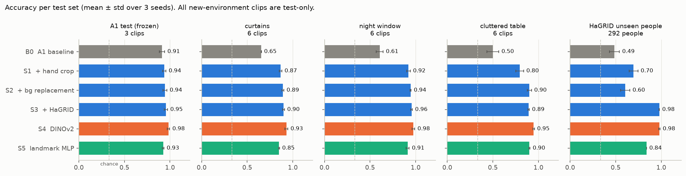

---

## 1. Dataset update

### 1.1 What was added

| part | images | clips / people | used for | split rule |
|---|---|---|---|---|
| A1 clips | 720 | 11 clips, 1 person | train 422 / val 98 / **frozen A1 test 200** | by clip, exactly as A1 |
| **A2 clips, 3 new environments** | 1,080 | 18 clips, 1 person | **test only** | whole clips |
| HaGRID subset (fist, peace, like→thumb) | 1,468 | 1,468 people | train 1,176 / test 292 | **by person** (`user_id`) |
| synthetic media | 0 | — | — | not used (§7) |

`results/a2/stage1_dataset_table.csv`:

| source | split | fist | peace | thumb | total |
|---|---|---|---|---|---|
| own | train | 147 | 146 | 129 | 422 |
| own | val | 33 | 34 | 31 | 98 |
| own | test (A1 + A2 clips) | 420 | 420 | 440 | 1,280 |
| HaGRID | train | 376 | 400 | 400 | 1,176 |
| HaGRID | test | 92 | 100 | 100 | 292 |

**External share:** HaGRID is **73.6%** of the training images and 44.9% of all images.
**Synthetic share: 0%.**

**New environments.** Recorded for A2 on the same phone (1072×1920, 60 fps, 6–12 s per clip), two clips per gesture in each of three places the model has never seen:
**curtains** (a room with curtains, filmed upwards against the window), **night** (a dark
window with city lights and reflections) and **table** (a cluttered table with food,
packaging and a kettle). 60 frames are sampled per clip with the A1 rule. All 18 clips are
test-only; nothing from them is used for training, tuning or as a background.
`thumb2_dark` and a second person's hand were planned but **not recorded**.

**HaGRID.** HaGRID (Kapitanov et al.) is a 552k-image gesture dataset recorded by
crowd-workers; we use the 384p sample `cj-mills/hagrid-sample-30k-384p` (CC BY-SA 4.0).
Only the needed members are read out of its 1 GB archive with HTTP range requests
(`scripts/download_hagrid.py`). A person goes to the held-out test pool when
`sha256(user_id) mod 5 = 0`, for all classes at once, so **no person appears in both train
and test** (asserted in the script). At most one image per person and class is kept, and
only a square crop of twice the hand box is stored, never the full frame. Hands smaller
than 40 px were skipped, so fist has 376 rather than 400 training crops. Hands are small:
median 59 px for fist, 89 px for peace, 74 px for thumb.

**Faces.** HaGRID gestures are usually shown next to the face, so even hand crops often
contain one. `scripts/blur_hagrid_faces.py` runs MediaPipe's BlazeFace on every crop and
blurs each detection that is not mostly inside the annotated hand box (the detector also
fires on knuckles): **383 faces in 319 of 1,468 crops** were blurred before any model saw
them. Faces were strongly class-correlated — about 28% of peace and thumb crops against
2–7% of fist crops — so blurring also removes a shortcut. Partial faces cut by the crop
border are not always detected, so **HaGRID images appear nowhere in this report, the
repository or the app**. On my own 1,800 frames the face detector flags 0 images at the
calibrated threshold (score ≥ 0.8; at 0.5 it fired on knuckles, all checked by eye).

**Full frames.** The A1 pipeline fed the model the central 1072×1072 square of each
portrait frame, discarding 44% of it. All own frames were re-read from the `.MOV` files at
540×960, so the hand pipeline crops from the whole camera view — as the app does. B0 keeps
its A1 input. `dataset/` and `metadata.csv` are untouched; everything new is in `dataset_v2/`.

### 1.2 Augmentation

Training-only and unchanged from A1 for every image model: random resized crop (0.7–1.0),
±20° rotation, horizontal flip, colour jitter, random erasing — no vertical flip, which would
turn a thumbs-up into a thumbs-down. From S2 on, **background replacement** is added
(p = 0.5): the SAM 2.1 hand mask is feathered and the hand is composited onto one of 282 DTD
textures (6 per class, Cimpoi et al.) or a random two-colour gradient. The landmark MLP is
augmented in landmark space (±20° rotation, ±10% scale, mirror, jitter). The pipeline on six
training frames is shown in Figure A1 (appendix).


---

## 2. SOTA method: a hand-centred pipeline (MediaPipe + SAM 2.1 + DINOv2)

> Neurohive pages: MediaPipe Hands — [Google Released New Real-time Hand Tracking Algorithm](https://neurohive.io/en/news/google-released-new-real-time-hand-tracking-algorithm/);
> SAM 2 — Neurohive has no dedicated SAM 2 article; [MedSAM2](https://neurohive.io/en/state-of-the-art/medsam2-open-source-sota-3d-medical-image-and-video-segmentation-model/)
> (listed in the brief) describes the SAM 2 architecture it is built on;
> DINOv2 — no dedicated article; its predecessor: [FAIR developed DINO architecture for self-supervised image analysis](https://neurohive.io/en/novosti/dino-en/).
> Papers: Zhang et al., *MediaPipe Hands* (2020); Ravi et al., *SAM 2: Segment Anything in Images and Videos* (2024);
> Oquab et al., *DINOv2: Learning Robust Visual Features without Supervision* (2023).


**The problem.** A1 diagnosed two failure causes: (1) the classifier sees the whole frame,
so it can learn the room instead of the hand; (2) at close range the hand does not fit the
fixed centre crop, and a thumbs-up loses the fist that tells it apart from a V-sign. Both are
fixed by **finding the hand first and classifying only the hand**.

**MediaPipe Hand Landmarker** (Google) is a two-stage model: a palm detector finds hand
regions, then a regression network places 21 3-D landmarks (wrist and four joints per
finger). It runs in real time on a CPU — 21 ms per frame here. The landmarks are used twice:
their bounding box gives a **square hand crop with a 25% margin** per side, scale- and
position-normalised with the whole hand in view; and the coordinates feed a tiny MLP (S5).
If no hand is found, the A1 centre square is used and the miss is logged.

**SAM 2.1** (Meta) is a promptable segmentation foundation model: a Hiera image encoder, a
prompt encoder and a light mask decoder that returns candidate masks with a predicted IoU.
We use the smallest checkpoint, `hiera-tiny`, prompted with the **landmark bounding box**,
and keep the candidate with the highest predicted IoU. (The plan was to prompt with the
landmarks as points; on a spot check, point prompts leaked onto the forearm or dropped
fingers, while the box gave clean masks.) The mask enables **background replacement**: the
same hand on hundreds of backgrounds, which attacks background memorisation directly. SAM
runs at training time (1,384 masks, 160 ms each on the GPU) and as an optional overlay in the
app — at 2.2 s per image on the CPU it is too slow for the default path.

**DINOv2** (Meta) is a ViT trained without labels on 142M curated images; its features
transfer with a linear probe. We use ViT-S/14 (22M parameters) with a head on [CLS, mean
patch token]: first a linear probe (S4-probe), then a light fine-tune of the last 4 blocks (S4).

**Why not the brief's suggestions for this topic.** Step-Video-T2V is a 30B-parameter
text-to-video model that needs about 77 GB of GPU memory; this project has a 4 GB laptop GPU.
ArtAug is an aesthetic LoRA for FLUX text-to-image generation — it improves generated images,
it does not repair low-light photos. Neither targets the failure causes A1 measured, and the
brief allows "a new/modern SOTA". Newer models exist (DINOv3 and SAM 3, both 2025): DINOv3's
weights are under a separate gated licence, and SAM 3 (~0.85B parameters) is far too slow for
a CPU demo, whereas SAM 2.1-tiny takes exactly the box prompt MediaPipe provides.

---

## 3. Experiments

### 3.1 Setup

Each change is added on top of the previous one, so consecutive differences form the ablation.

| model | what it is | trained on |
|---|---|---|
| **B0** | A1 ResNet-18 on the A1 centre square (reproduced exactly, §3.2) | 422 own frames |
| **S1** | + MediaPipe hand crop | 422 own frames |
| **S2** | + SAM 2.1 background replacement (p = 0.5) | 422 own frames |
| **S3** | + HaGRID training crops | 422 own + 1,176 HaGRID |
| **S4-probe / S4** | DINOv2 ViT-S/14 on the S3 pipeline: linear probe / light fine-tune | same as S3 |
| **S5** | MLP on 21 normalised MediaPipe landmarks; no hand → counted as an error | 1,384 detected hands |

Image models use the A1 recipe: 6 head-only epochs (lr 1e-3), then fine-tuning (ResNet: 12
epochs at 5e-5, all layers; DINOv2: 8 epochs at 2e-5, last 4 blocks), AdamW, cosine schedule,
label smoothing 0.05, best-validation weights. Validation is the A1 one (the last 20% of each
training clip). **Every model is trained with 3 seeds (42, 43, 44)**; tables report mean ±
std. Training ran on an RTX 3050 Ti (4 GB): ~80 s per seed for S1/S2, ~6 min for S3/S4.

### 3.2 Stage 0 — the A1 result, reproduced

The A1 code was refactored into `src/`. With seed 42 in the A1 environment
(torch 2.14.0+cpu) it reproduces A1 **bit for bit**: acc 0.945, macro-F1 0.947, 11 errors,
all thumb→peace, identical per-epoch logs. Seeds 43 and 44 give 0.890 and 0.905, so the
honest baseline is **0.913 ± 0.028** — A1's single number was the luckiest of three. All
B0 errors in every seed are in one clip (`thumb2`), and the same 11 frames are wrong in all
three seeds. Seed 43 has the best validation accuracy (1.000) and the worst test accuracy,
confirming A1's warning that same-clip validation cannot select models.

### 3.3 Baseline vs SOTA, per environment

Accuracy, mean ± std over 3 seeds (`stage3_per_env.csv`). "New envs" pools the 18 A2 clips.

| model | A1 test | **new envs** | curtains | night | table | HaGRID people |
|---|---|---|---|---|---|---|
| B0 (A1) | 0.913 ± 0.028 | **0.586 ± 0.010** | 0.654 ± 0.002 | 0.606 ± 0.038 | 0.499 ± 0.066 | 0.486 ± 0.055 |
| S1 + crop | 0.938 ± 0.018 | 0.861 ± 0.010 | 0.866 ± 0.014 | 0.922 ± 0.019 | 0.795 ± 0.042 | 0.696 ± 0.048 |
| S2 + bg replacement | 0.945 ± 0.022 | 0.912 ± 0.009 | 0.892 ± 0.010 | 0.944 ± 0.006 | 0.900 ± 0.024 | 0.605 ± 0.050 |
| S3 + HaGRID | 0.955 ± 0.018 | 0.915 ± 0.004 | 0.898 ± 0.011 | 0.956 ± 0.008 | 0.893 ± 0.007 | 0.978 ± 0.002 |
| S4-probe (DINOv2) | 0.828 ± 0.028 | 0.778 ± 0.047 | 0.773 ± 0.063 | 0.878 ± 0.048 | 0.683 ± 0.044 | 0.949 ± 0.003 |
| **S4 (DINOv2)** | **0.983 ± 0.013** | **0.951 ± 0.012** | **0.930 ± 0.015** | **0.976 ± 0.014** | **0.947 ± 0.008** | **0.979 ± 0.007** |
| S5 (landmarks) | 0.925 ± 0.009 | 0.888 ± 0.007 | 0.849 ± 0.004 | 0.913 ± 0.016 | 0.901 ± 0.006 | 0.839 ± 0.000 |

Macro-F1 on the new environments: B0 0.563, S1 0.853, S2 0.911, S3 0.914, S4 **0.950**,
S5 0.907. MediaPipe found a hand in 94% (curtains, night) and 98% (table) of the new frames.

**How certain is this?** Frames of one clip are near-duplicates, so the uncertainty comes
from the 18 clips, not the 1,080 frames. Resampling whole clips (within class,
`stage3_clip_ci.csv`): B0 **0.506–0.668**, S1 0.775–0.942, S2 0.848–0.974, S3 0.850–0.975,
S4 **0.907–0.991**, S5 0.822–0.946. B0 vs every crop-based model is a clear difference;
S2, S3 and S4 overlap, so the ordering among them is *not* established. The A1 test set has
one clip per class, so no clip-level interval can be computed at all — new recordings were
the only way to make a generalisation claim.

**Per class (new envs, recall).** B0: fist 0.491, peace 0.998, thumb **0.270** — in unseen
rooms it calls almost everything "peace". S4: fist 0.997, peace 0.992, thumb 0.864. The
remaining S4 errors are thumbs (on the table: thumb→fist 7–19 and thumb→peace 3–8 per seed).
Confusion matrices: Figure A2.


### 3.4 Ablation

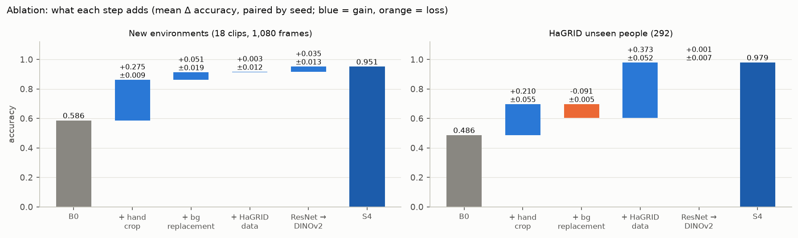

Change in accuracy from each step, paired by seed (`stage3_ablation.csv`):

| step | A1 test | **new envs** | HaGRID people |
|---|---|---|---|
| hand crop (S1 − B0) | +0.025 ± 0.013 | **+0.275 ± 0.009** | +0.210 ± 0.055 |
| background replacement (S2 − S1) | +0.007 ± 0.010 | **+0.051 ± 0.019** (table: +0.105) | **−0.091 ± 0.005** |
| HaGRID data (S3 − S2) | +0.010 ± 0.033 | +0.003 ± 0.012 | **+0.373 ± 0.052** |
| DINOv2 instead of ResNet-18 (S4 − S3) | +0.028 ± 0.029 | +0.035 ± 0.013 | +0.001 ± 0.007 |

* **The hand crop does most of the work** in every environment (+0.21 to +0.32).
* **Background replacement helps exactly where the background is busy** (cluttered table
  +0.105), but *hurts* on HaGRID people (−0.091). A likely reason: HaGRID crops are small and
  blurry, while the replaced backgrounds are sharp textures; with only my own hand in
  training, S2 may learn "sharp edges around a hand" cues that do not transfer. Adding HaGRID
  (S3) removes the problem. This is a hypothesis, not tested here.
* **HaGRID adds nothing in my own new rooms** (+0.003) — it matters only for other people's
  hands, where it takes accuracy from 0.605 to 0.978. For S3/S4 the HaGRID test is the same
  distribution as their training data (new people, same capture style), so their 0.98 there
  measures generalisation to new people, not to new conditions.
* **DINOv2 vs ResNet-18** is +0.035 on the pooled new environments, within the clip-level
  uncertainty. Its linear probe alone (0.778) is much worse — the light fine-tune matters.

### 3.5 The A1 close-up errors, before and after

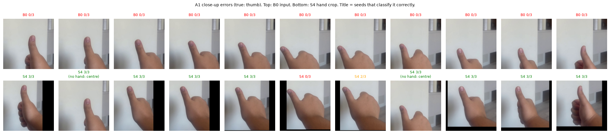

On the 11 frames that B0 misclassifies with **every** seed, S4 is right in **29 of 33**
(frame × seed) cases (`stage3_closeups.csv`). MediaPipe finds the hand in 9 of the 11; on
average 27.5% of its landmarks lie outside the A1 centre square — the crop gives the model
the part of the hand A1 cut off. The same is true of correctly classified `thumb2` frames
(31.6%), so the cut-off hand is a property of the whole clip, not only of the errors.

### 3.6 Training curves (Figure A3)

All image models fit the training clips within a few epochs of unfreezing; validation
accuracy peaks at 0.94–1.00 for every image model, so (as A1 found) it cannot rank them —
only the held-out environments can.

### 3.7 Latency and size

CPU, batch 1, median / p95 over 50 runs (AMD Ryzen 5 5600H, 6 threads, torch 2.14.1;
`stage3_latency.csv`, `stage3_model_size.csv`):

| component | median ms | p95 ms | | end to end (frame → probabilities) | median ms | p95 ms |
|---|---|---|---|---|---|---|
| MediaPipe Hand Landmarker | 21.4 | 22.4 | | B0: centre square + ResNet-18 | 20.3 | 27.3 |
| ResNet-18 (224 px) | 22.5 | 26.4 | | S3: MediaPipe + crop + ResNet-18 | 54.1 | 61.9 |
| DINOv2 ViT-S/14 (224 px) | 57.2 | 63.3 | | **S4: MediaPipe + crop + DINOv2** | **84.9** | **96.9** |
| landmark MLP | 0.1 | 0.1 | | S5: MediaPipe + landmark MLP | 21.7 | 22.4 |
| SAM 2.1 hiera-tiny (256 px crop) | 2187.9 | 2322.7 | | S3 + SAM 2.1 overlay (app option) | 2144.4 | 2311.8 |

| model | parameters | size |
|---|---|---|
| ResNet-18 | 11.2 M | 44.8 MB |
| DINOv2 ViT-S/14 + head | 22.1 M | 88.3 MB |
| landmark MLP | 16.6 k | 0.1 MB |
| SAM 2.1 hiera-tiny | 31.4 M | 125.8 MB |
| MediaPipe Hand Landmarker | — | 7.8 MB |

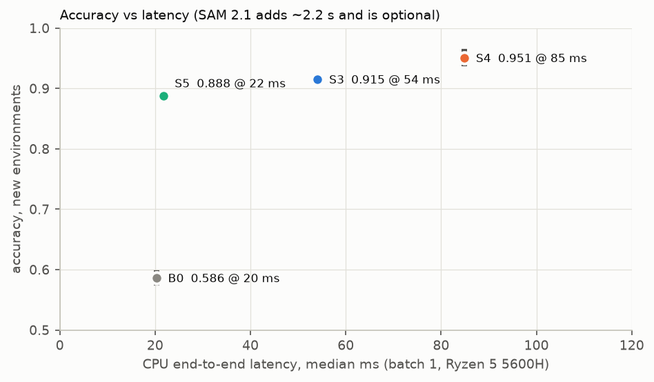

S4 is ~12 frames/s on a laptop CPU — real-time enough for the demo. The landmark MLP is the
efficiency outlier: 0.888 on new environments at 22 ms, and most of its errors are frames
where MediaPipe found no hand (on detected hands it is right 98% of the time on the A1 test
and HaGRID, 93% on the new environments).

---

## 4. Explainability

Grad-CAM (ResNet-18) and attention rollout (DINOv2) are computed on each model's own input,
and a SAM 2.1 hand mask is computed *for that same input*. The score is the share of the
heatmap that falls on the hand; the mask's area is the chance level (seed 42,
1,219 own test frames with a detected hand, `stage4_summary.csv`).

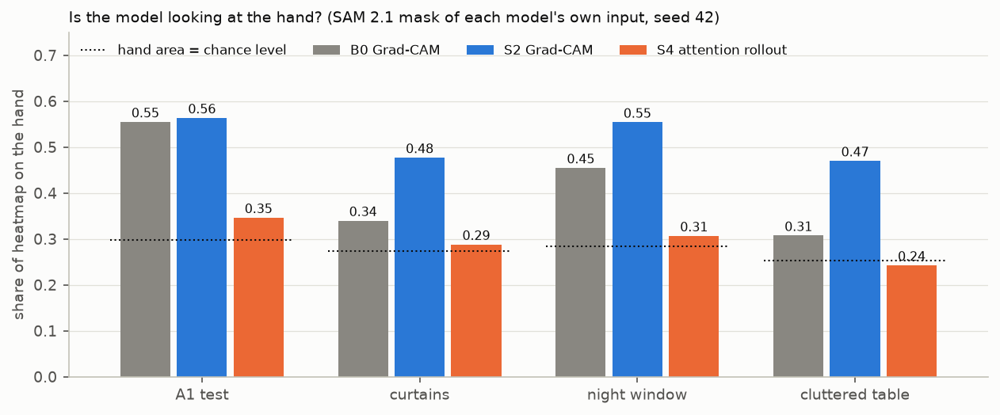

| model | method | heatmap on hand | hand area (chance) | lift |
|---|---|---|---|---|
| B0 | Grad-CAM | 0.396 | 0.256 | 1.57× |
| **S2** | Grad-CAM | **0.510** | 0.274 | **1.89×** |
| S3 | Grad-CAM | 0.489 | 0.274 | 1.80× |
| S4 | attention rollout | 0.289 | 0.274 | 1.12× |

* **This confirms A1's background hypothesis — for unseen rooms.** On the A1 test set B0 and
  S2 look at the hand equally (0.555 vs 0.563). In new rooms B0's attention moves off the hand
  (cluttered table 0.307, barely above the 0.25 hand area) while S2's stays on it (0.470).
* **The rollout number for DINOv2 is not evidence of background reliance.** The maps show
  isolated hot spots on background and padding tokens — the known "high-norm token" artefact
  of DINOv2 without register tokens (Darcet et al., 2023). Rollout is a weak explanation for
  this backbone; a register-equipped DINOv2 or a gradient-based ViT method would be the fix
  (not run). Example heatmaps: Figure A4.


---

## 5. The app

A Gradio app (`app/app.py`) runs locally (instructions in `README.md`) and is ready for a
Hugging Face Space. The **Predict** tab takes an upload or a webcam photo and shows: class
probabilities; the MediaPipe landmarks and crop window; Grad-CAM (ResNet) or attention rollout
(DINOv2) on the model input; an optional SAM 2.1 mask; a per-stage latency table; and the
environment (OS, Python, torch, inference device, browser user-agent). A selector switches
between **B0** and the A2 model for a side-by-side defense. The **About & Ethics** tab lists
sources, licences, the privacy notice and limitations.

| | |
|---|---|
| 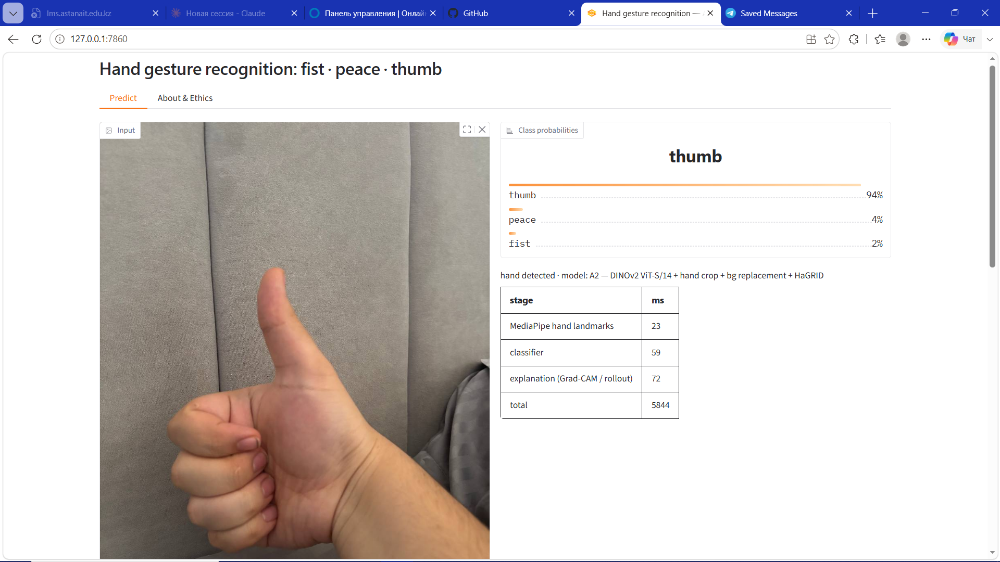 | 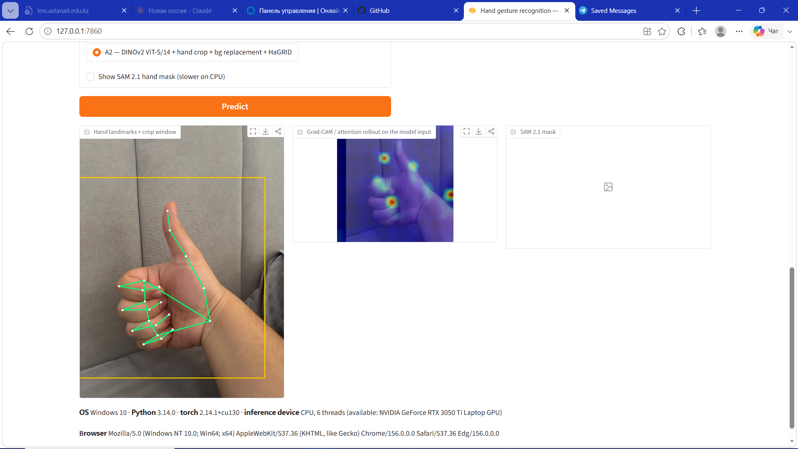 |
| 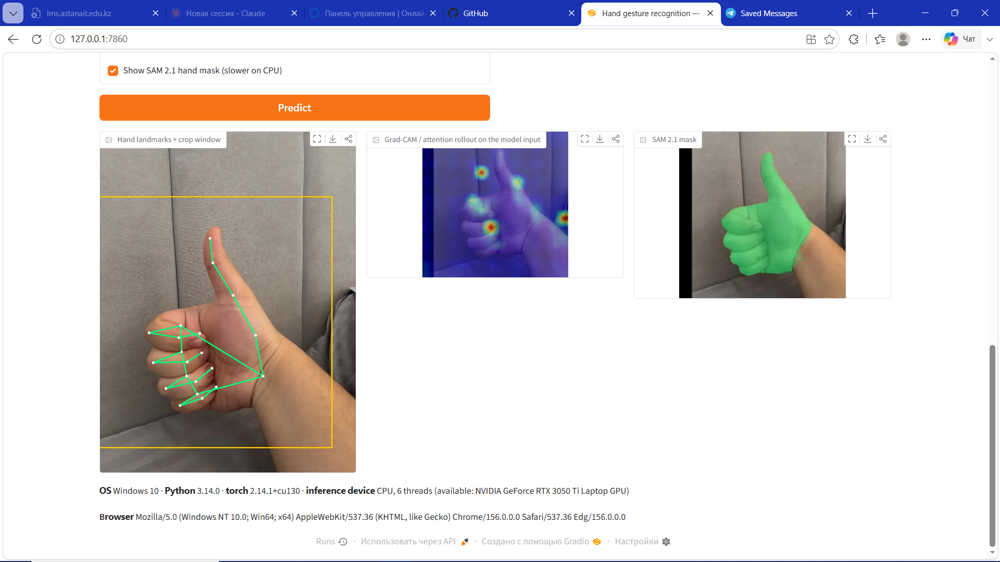 |  |

*Screenshots of the local app (Edge on Windows 10). The "total 5844 ms" in the first
screenshot is the first request, which loads the model; later requests take ~170 ms, plus
~2.2 s with the SAM option.*

---

## 6. Ethics and limitations

**Consent and privacy.** All own recordings show only my own hand; no faces were recorded
(0 of 1,800 own frames flagged by the face detector). HaGRID was collected from
crowd-workers by its authors and is used under CC BY-SA 4.0 (attribution in the app and here);
faces in its crops were blurred before training, and HaGRID images are neither shown nor
redistributed — the repository contains a download script instead. The app processes images
in memory and does not store them; Gradio's temporary upload cache is cleared automatically
(`delete_cache`), and the About tab asks users not to upload other people without consent.

**Bias.** The own data is one person's right hand, one skin tone, indoors only; HaGRID adds many hands
but at low resolution and in selfie framing. Performance on other skin tones, gloves, left
hands at close range or outdoor daylight is untested (no outdoor clip was recorded).

**Misuse.** A gesture classifier is low-risk, but hand-tracking pipelines can be used for
covert monitoring. The app runs on demand only, keeps no data and states that it must not be
used to identify or monitor people.

**Synthetic media.** None was generated or used; the planned synthetic stress test (§7) was
not run, so there is nothing to label.

**Limitations.**
* **Small number of independent recordings:** 3 A1 test clips and 18 new clips, all of one
  person — see the clip-level intervals in §3.3.
* **Model selection uses same-clip validation** (A1 protocol, kept for comparability).
* **For S3/S4, the HaGRID test is in-distribution** (new people, same capture style).
* **HaGRID hand sizes differ by class** (fist smallest), a possible resolution shortcut.
* **Hand crops at the frame border are zero-padded**; the black bars are present in both
  training and test, but are a visible artefact (and attract DINOv2 rollout).
* **Hand detection fails on 2–6% of own frames** and 14% of HaGRID crops; those frames fall
  back to the centre square (image models) or count as errors (S5).

---

## 7. Not run

* **Synthetic stress test** (Wan2.1-T2V-1.3B in Colab) — not run for lack of time.
* **Nearest-neighbour gallery** (optional explainability) — not run.
* `thumb2_dark`, an outdoor environment and a second person's hand — not recorded.
* Hugging Face Space — prepared but not deployed (needs the author's account).

---

## 8. Reproducibility

**Environment.** Python 3.14, Windows 10, a separate venv (`requirements_a2.txt`; mediapipe
needs `opencv-contrib-python`, which must not share an environment with A1's
`opencv-python`). CUDA torch for training; CPU is enough for evaluation and the app. All
paths work under a Cyrillic folder name (`imread_unicode` / `imencode().tofile()`).

**Commands** (from the repository root; each stage writes `results/a2/*.csv` and
`figures/a2/*.png`; `FAST_MODE=1` shortens training and writes `*_fast` files only):

```bash
python scripts/stage0_reproduce.py          # A1 reproduction = B0 (run in the A1 environment)
python scripts/download_hagrid.py           # HaGRID subset, split by person
python scripts/blur_hagrid_faces.py         # privacy step
python scripts/build_dataset_v2.py          # A1 frames + raw_v2/*.MOV + HaGRID -> dataset_v2/
python scripts/stage1_report.py             # dataset table, face check
python scripts/prepare_textures.py          # DTD texture bank
python scripts/precompute_hands.py          # MediaPipe + crops + SAM 2.1 masks
python scripts/stage3_train.py              # B0, S1-S5 x 3 seeds   (--eval-only: re-evaluate saved weights)
python scripts/stage3_analyze.py && python scripts/stage3_clip_ci.py && python scripts/stage3_latency.py
python scripts/stage4_explain.py && python scripts/make_report_figures.py
python app/app.py                           # demo at http://127.0.0.1:7860
```

`a2_experiments.ipynb` runs top to bottom and shows every table and figure above
(`A2_RETRAIN=1` re-runs the stages). Seeds: 42, 43, 44. Weights are re-created by
`stage3_train.py` (they are not in git). The raw videos are not in the repository (personal
data); the derived A1 dataset is.

---

## Appendix — additional figures

**Figure A1 — the hand pipeline on six training frames: original, landmarks + crop window, SAM 2.1 mask, hand crop, background replaced.**

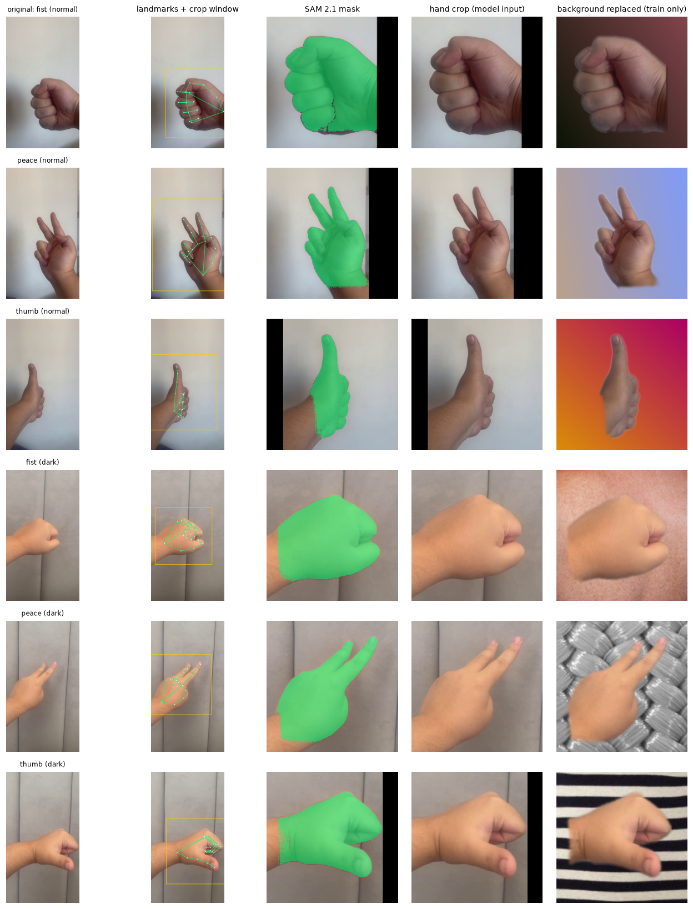

**Figure A2 — confusion matrices, summed over 3 seeds.**

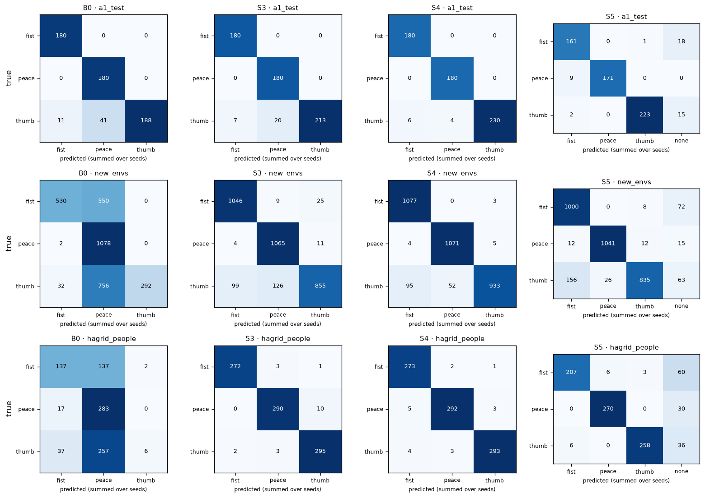

**Figure A3 — training curves, mean over 3 seeds.**

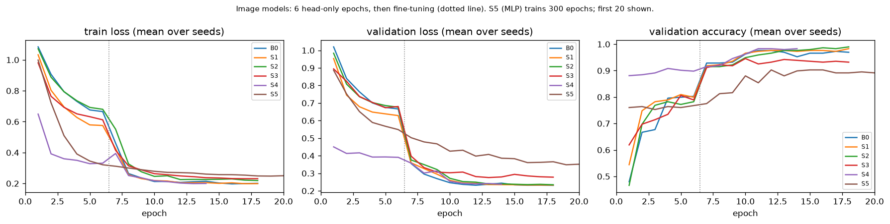

**Figure A4 — Grad-CAM (B0, S2) and attention rollout (S4) on the same frames, seed 42.**

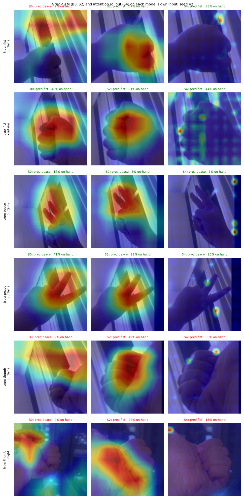
