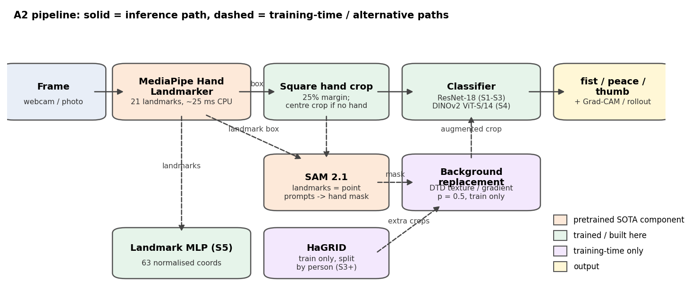

# Hand Gesture Recognition, Level-Up: SOTA Hand Pipeline + Demo

**Computer Vision — Assignment 2 (continuation of Assignment 1)**

Assignment 1 classified three static gestures — **fist**, **peace**, **thumb** (thumbs-up) —
from 11 phone recordings of my own hand. Its best model, an ImageNet ResNet-18, reached
0.945 accuracy on three held-out clips, but two problems were left open: every remaining
error was a close-up thumb, and the classical baselines had memorised the two training
backgrounds. Assignment 2 adds state-of-the-art components aimed at exactly those two
causes, measures every step against the A1 baseline on new environments, and ships a demo.

Every number below is read from `results/a2/*.csv`, written by the scripts in `scripts/`.
"Not run" marks anything that was planned but not executed.

---

## 1. Dataset update

### 1.1 What was added

| part | images | people | used for | split rule |
|---|---|---|---|---|
| A1 clips (11 recordings) | 720 | 1 | train / val / **frozen A1 test** | by clip, exactly as A1 |
| A2 clips (new environments) | RESULTS_PENDING | RESULTS_PENDING | **test only** | whole clips |
| HaGRID subset (fist, peace, like→thumb) | 1,468 | 1,468 | train 1,176 / test 292 | **by person** (`user_id`) |
| synthetic media | 0 | — | — | not used |

`results/a2/stage1_dataset_table.csv`:

| source | split | fist | peace | thumb | total |
|---|---|---|---|---|---|
| HaGRID | train | 376 | 400 | 400 | 1,176 |
| HaGRID | test | 92 | 100 | 100 | 292 |
| own | train | 147 | 146 | 129 | 422 |
| own | val | 33 | 34 | 31 | 98 |
| own (A1 test) | test | 60 | 60 | 80 | 200 |

**External share:** HaGRID is 73.6% of the training images (67.1% of all images).
**Synthetic share: 0%.**

**HaGRID.** HaGRID (Kapitanov et al.) is a 552k-image gesture dataset recorded by
crowd-workers; we use the 384p sample `cj-mills/hagrid-sample-30k-384p` (CC BY-SA 4.0).
Only the members we need are read out of its 1 GB archive over HTTP range requests
(`scripts/download_hagrid.py`). Every annotation carries a `user_id`; a person goes to the
held-out test pool when `sha256(user_id) mod 5 = 0`, for all classes at once, so **no
person appears in both train and test** (asserted in the script). At most one image per
person per class is kept, and only a square crop of twice the hand box is stored, never
the full frame. Hands smaller than 40 px (longer box side) were skipped, which is why
fist has 376 rather than 400 training crops. Median hand size is small — 59 px for fist,
89 px for peace, 74 px for thumb — a resolution difference between classes that a model
could in principle exploit; we note it as a limitation (§5).

**Faces.** HaGRID gestures are usually shown next to the face, so even the hand crops
often contain one. `scripts/blur_hagrid_faces.py` runs MediaPipe's BlazeFace on every crop
and blurs each detection that is not mostly inside the annotated hand box (the detector
also fires on knuckles): **383 faces in 319 of 1,468 crops** were blurred before any model
saw them. Faces are strongly class-correlated in HaGRID — about 28% of peace and thumb
crops contained one, against 2–7% of fist crops — so blurring also removes a shortcut.
Partial faces cut by the crop border are not always detected; HaGRID images therefore
appear nowhere in this report, the repository or the app (§5).

**Own data.** The A1 clips were re-read from the original `.MOV` files: alongside the A1
224 px centre square (B0's input), every sampled frame is stored as the full portrait frame
(540×960), from which the hand pipeline crops. The A1 crop discarded 44% of each frame; the
hand pipeline sees all of it. The face detector flagged 0 of 720 own frames at the
calibrated threshold (score ≥ 0.8; at 0.5 it fired on knuckles in 109 frames, all checked
by eye — no faces).

### 1.2 Augmentation

Training-only, unchanged from A1 for every image model (random resized crop 0.7–1.0,
±20° rotation, horizontal flip, colour jitter, random erasing; no vertical flip, which
would turn a thumbs-up into a thumbs-down). From S2 on, **background replacement** is
added (p = 0.5, training images only): the SAM 2.1 hand mask is feathered and the hand is
composited onto one of 282 DTD textures (6 per class) or a random two-colour gradient.
Nothing from the A1 test clips or from the new test environments is ever used as a
background. The landmark MLP is augmented in landmark space (±20° rotation, ±10% scale,
mirror, jitter).

---

## 2. SOTA method: a hand-centred pipeline (MediaPipe + SAM 2.1 + DINOv2)

> One-page explainer in the style of a Neurohive article.
> MediaPipe Hands: [NEUROHIVE LINK] · SAM 2: [NEUROHIVE LINK] · DINOv2: [NEUROHIVE LINK]

**The problem it solves.** A1 diagnosed two failure causes: (1) the classifier sees the
whole frame, so it can learn the room instead of the hand; (2) at close range the hand
does not fit the fixed centre crop, and the thumbs-up loses the fist that distinguishes
it from a V-sign. Both are fixed by *finding the hand first* and classifying only the hand.

**MediaPipe Hand Landmarker** (Google) is a two-stage detector: a palm detector finds hand
regions, then a regression network places 21 3-D landmarks (wrist, four joints per
finger) and estimates handedness. It runs in real time on a CPU (28 ms per 540×960 frame
here, `stage2` log). We use the landmarks twice: their bounding box gives a **square hand
crop with a 25% margin** on each side — scale- and position-normalised, with the whole
hand in view even when it extends past the old centre square — and the coordinates
themselves feed a tiny MLP (S5). When no hand is found, the A1 centre square is used and
the miss is logged.

**SAM 2.1** (Meta, "Segment Anything in Images and Videos") is a promptable segmentation
foundation model: a Hiera image encoder, a prompt encoder for points/boxes and a light
mask decoder that returns candidate masks with predicted IoU. We use the smallest
checkpoint, `hiera-tiny`, prompted with the **landmark bounding box**; of its 3 candidate
masks the one with the highest predicted IoU is kept. (The plan was to prompt with the
landmarks as points; on a spot check, point prompts leaked onto the forearm or dropped
fingers, while the box gave clean masks, so the box is what is used.) The mask makes
**background replacement** possible: the same hand on hundreds of new backgrounds,
directly attacking background memorisation. SAM runs at training time only (and as an
optional overlay in the app), because it is the slowest component.

**DINOv2** (Meta) is a self-supervised ViT trained on 142M curated images without labels;
its features transfer with a linear probe. We use ViT-S/14 (22M parameters, like
ResNet-18's 11M in scale) with a head on [CLS, mean patch token]: first a linear probe
(S4-probe), then a light fine-tune of the last 4 blocks (S4), and explain it with
attention rollout.

**Why not the brief's suggestions for this topic.** The brief suggests Step-Video-T2V and
ArtAug. Step-Video-T2V is a 30B-parameter text-to-video model that needs about 77 GB of GPU
memory for its default setting; this project has a 4 GB laptop GPU. ArtAug is an aesthetic
LoRA for FLUX text-to-image generation — it improves the look of generated images, it does
not repair low-light photos — and neither targets the two failure causes A1 measured. The
brief allows "a new/modern SOTA", so the components were chosen for the measured failure
modes. Newer models exist (DINOv3, 2025; SAM 3, 2025): DINOv3 weights are distributed
under a separate gated licence, and SAM 3 (~0.85B parameters) is far too slow for a CPU
demo, whereas SAM 2.1-tiny accepts exactly the box prompt that MediaPipe provides.

---

## 3. Experiments

RESULTS_PENDING — Stage 3 (models B0, S1–S5 × 3 seeds; per-environment table, ablation,
training curves, latency, before/after on the A1 close-up errors).

---

## 4. Explainability

RESULTS_PENDING — Stage 4 (Grad-CAM / attention rollout, share of heatmap on the hand).

---

## 5. Ethics and limitations

RESULTS_PENDING — written after the results (consent, HaGRID licence and faces,
image retention in the app, bias, misuse, synthetic-media disclosure, limitations).

---

## 6. Reproducibility

RESULTS_PENDING — environment, commands, weights, inputs (mirrors README.md).
